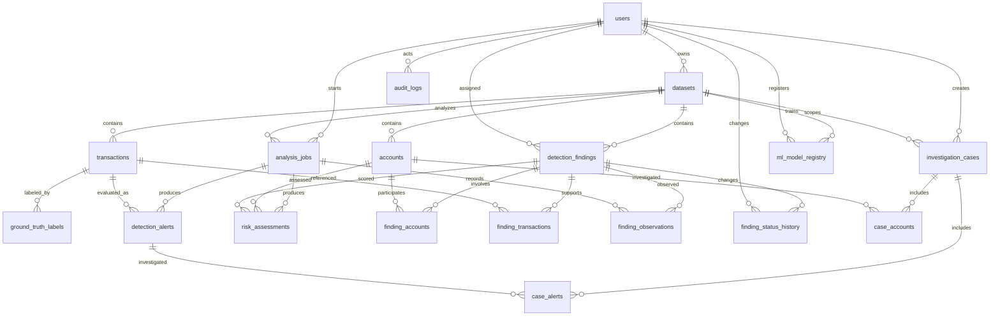

# MuleTrace Architecture

This document describes the architectural foundation for the **MuleTrace** full-stack system.

## 1. High-Level Architecture Overview

MuleTrace is architected as a decoupled, multi-tier full-stack application:

```
+----------------------------------------------------------------+
|                         Browser / Client                       |
|               React (TypeScript) + Vite + Tailwind             |
|              Cytoscape.js (Graphs) + Recharts (Metrics)        |
+-------------------------------+--------------------------------+
                                |
                     HTTP / REST Requests
                     JSON Data Exchange
                                |
                                v
+-------------------------------+--------------------------------+
|                      Backend API (FastAPI)                     |
|           Endpoints, Middleware (CORS), Pydantic Config        |
+-------------------------------+--------------------------------+
                                |
                       SQLAlchemy 2.0 ORM
                                |
                                v
+-------------------------------+--------------------------------+
|                    Relational Database                         |
|                         PostgreSQL                             |
+----------------------------------------------------------------+
```

## 2. Directory Layout & Boundary Separation

- **`frontend/`**: Contains the client application built with Vite, React, and TypeScript.
  - UI styled using Tailwind CSS and shadcn/ui component conventions.
  - Visualization powered by Cytoscape.js (graph/network representations) and Recharts (analytics/metrics).
  - Tests powered by Vitest and React Testing Library.
- **`backend/`**: Contains the Python FastAPI service.
  - Modular structure (`app/core/` for configs and database connections).
  - Database access managed through SQLAlchemy `SessionLocal` dependencies.
  - Automated tests running via Pytest and FastAPI's HTTPX-based `TestClient`.
- **`postman/`**: Pre-configured Postman collections and environments for manual and automated API validation.
- **`docs/`**: Setup, architecture, and team collaboration documentation.

## 3. Communication Contract

- Frontend communicates with Backend using standard RESTful HTTP methods.
- Default local frontend origin: `http://localhost:5173`
- Default local backend API: `http://localhost:8000`
- New application endpoints are grouped under `/api/v1` so future API changes can be versioned.
- Interactive OpenAPI documentation is accessible at `http://localhost:8000/docs`.
- Process liveness is available at `/health/live`; `/health` remains as a compatible legacy liveness route.
- Readiness is available at `/health/ready` and checks the configured database connection.

## 4. Backend Foundation

- Settings are loaded from process environment variables, the project-root `.env`, and `backend/.env`; process variables have highest precedence and `backend/.env` overrides the root file.
- Database credentials have no code defaults. `DATABASE_URL` is an optional explicit SQLAlchemy URL; otherwise, the URL is composed from `POSTGRES_*` settings when both user and password are configured.
- SQLAlchemy 2.x manages the engine and request-scoped sessions. Readiness executes `SELECT 1` against the configured PostgreSQL service.
- Alembic manages schema migrations. Revision `0001_empty_baseline` is followed by the initial relational schema, authentication, transaction indexes, import tracking, persisted findings and versioned risk scores, ML model metadata, and `c7e4a91d2f60` for asynchronous analysis lifecycle state.
- Compose uses the project name `muletrace`, containers `muletrace-postgres` and `muletrace-redis`, network `muletrace_network`, and localhost ports 5432 and 6379.
- Persistent external volumes `mule-trace_postgres_data` and `mule-trace_redis_data` retain the Phase 2 data across the Compose project-name change.
- Future application containers must use images built from current MuleTrace Dockerfiles and unique MuleTrace image names. Rebuilds preserve the database volumes.
- Application request logs are emitted as JSON and include a generated request ID. Error responses use a shared `error` envelope and do not echo submitted validation values.

## 5. Relational Schema

SQLAlchemy 2.x typed declarative models are grouped under `backend/app/models/`. PostgreSQL UUID primary keys are generated by the application, monetary values use fixed-precision `NUMERIC`, and timestamps use timezone-aware columns normalized to UTC. JSONB is used for source metadata, analysis parameters and summaries, detection evidence, risk rationale, and audit details.

The schema includes `User`, `Dataset`, `Account`, `Transaction`, `AnalysisJob`, `DetectionAlert`, `DetectionFinding`, `FindingAccount`, `FindingTransaction`, `FindingObservation`, `FindingStatusHistory`, `RiskAssessment`, `InvestigationCase`, `CaseAccount`, `CaseAlert`, `MLModelRegistryRecord`, and `AuditLog`. `GroundTruthLabel` is a separate model/table so synthetic, curated, and imported labels cannot be confused with detection output.

Transactions are dataset-scoped and reference sender and receiver accounts through composite foreign keys. There is no uniqueness constraint on the account pair, so multiple transfers between the same accounts remain distinct transaction records. Alerts and risk assessments are tied to analysis jobs and records in the same dataset; case memberships similarly enforce dataset consistency.

Deletion policies preserve investigation and audit history: deleting a case cascades only to its membership rows; deleting a dataset cascades its accounts, transactions, labels, and analysis outputs but is restricted while cases exist; deleting an account is restricted while transaction, case, or finding references exist; deleting a user is restricted while they own datasets. Actor references on jobs, cases, labels, memberships, findings, and audit events become null when a user is deleted. Audit entity IDs are polymorphic and intentionally have no cascading foreign key.



## 6. Authentication and Authorization

Authentication code is separated across `app/api/` route handlers, `app/schemas/auth.py` request/response models, `app/services/auth.py` workflows and audit events, and `app/security/` password/JWT utilities. Passwords use Argon2id. JWT access tokens use HS256 with required `sub`, `iss`, `aud`, `iat`, `nbf`, `exp`, `jti`, and `token_type` claims. Each protected request resolves the token subject to the current active user in PostgreSQL, allowing activation and role changes to apply without waiting for token expiry.

The roles are `ADMIN`, `INVESTIGATOR`, and `ANALYST`. Registration always assigns `ANALYST`. Administrator-only endpoints manage activation and roles, and guard against removing the last active administrator. Registration, successful and failed login, bootstrap, activation, deactivation, and role changes are recorded in `audit_logs`; failed authentication events deliberately omit submitted email and password data. Existing pre-authentication accounts keep a nullable password hash and cannot sign in until an operator provisions a new password through an approved process.

`JWT_SECRET_KEY` has no code default and must be a randomly generated environment secret of at least 32 characters. The first administrator is provisioned from the CLI only when no active administrator exists; after that, role management requires an administrator token.

## 7. Accounts and Transactions API

Account and transaction routes live in `app/api/accounts.py` and `app/api/transactions.py`; request schemas are in `app/schemas/`, and persistence, ownership checks, and audit behavior are in `app/services/`. Both resources use nested `/api/v1/datasets/{dataset_id}/...` routes. Each operation checks the active token user's dataset ownership. Dataset/account mismatches are rejected before writes, while the transaction table's composite foreign keys remain the final integrity boundary. List responses share page metadata, account transaction counts use a correlated count expression, and transaction records are returned without additional account queries.

Transaction list filters cover account IDs, amount bounds, currency, and time bounds. Existing sender/receiver/time indexes plus revision `c42d9d0a8b31` indexes support these filters. Repeated transactions between an account pair remain permitted. Resource audit events are committed atomically with creates and updates and contain only dataset IDs and changed field names.

## 8. Dataset Lifecycle, Synthetic Generation, and CSV Imports

Dataset routes in `app/api/datasets.py` enforce owner scope and return account/transaction summary counts through aggregate subqueries. The synthetic generator in `app/services/synthetic_data.py` is seed-deterministic and writes generated labels to `ground_truth_labels` with `source='synthetic'`; it never writes to `detection_alerts`. It is synchronous and accepts only empty datasets.

CSV endpoints in `app/api/imports.py` use multipart `UploadFile` spooling and fixed configurable byte/row caps. Canonical account/transaction formats are defined in `docs/DATASETS_SYNTHETIC_CSV.md`. Parsing is bounded, transaction/account resolution is dataset-scoped, external IDs support safe retry skips, and a file with invalid rows does not partially commit. `ImportJob` rows track filename, type, state, counts, error summary, and timestamps. The pending job is committed first so failed attempts remain visible; successful data rows, job completion, and audit events commit together.

## 9. Financial Transaction Graph Engine

The pure NetworkX graph modules in `app/graph/` build transaction-preserving `MultiDiGraph` objects, account metrics, network components, bounded neighborhoods/paths, and stable JSON serialization. `app/services/graph.py` owns the database boundary: it checks dataset ownership before querying, selects only required columns, filters by the selected dataset, and bounds reads to the configured node and edge limits. Graph construction is not exposed as an API in this phase. Parallel transfers remain distinct edge keys, monetary totals remain currency-specific `Decimal` values, and the serializer excludes account metadata and external identifiers. Full semantics and limits are documented in `docs/GRAPH_ENGINE.md`.

## 10. Suspicious Pattern Detection

The pure Phase 8 detectors in `app/detection/` consume the transaction-preserving Phase 7 `MultiDiGraph` and return deterministic findings. They cover rapid transfers, fan-in/out, bounded circular and multi-hop movement, within-account activity deviations, and configurable per-currency amount-band activity. The sequential orchestrator records disabled and failed detector states without discarding successful detector results. Ground-truth labels and arbitrary account/transaction metadata are not detector inputs.

Thresholds, evidence contracts, time boundaries, limits, complexity, and known limitations are described in `docs/DETECTION_ENGINE.md`. `DetectionAlert` remains a transaction-level model and is not used to flatten multi-transaction findings.

## 11. Finding Persistence, Risk Scoring, and Lifecycle

Phase 9's `DetectionFinding` has dataset-scoped deduplication and stable finding IDs. `FindingAccount` and `FindingTransaction` preserve all account and transaction references with composite dataset foreign keys. `FindingObservation` stores an immutable evidence and parameter snapshot per analysis job, while the canonical finding exposes the latest detector output. Reprocessing the same job is idempotent; a repeated key from a later job adds an observation and advances the last-detected time. Findings omitted from a later run remain available for review.

`app/services/findings.py` persists detector output independently of HTTP handlers and records lifecycle changes. `app/services/risk_scoring.py` calculates and stores one score per finding and one aggregate score per affected account for each analysis job and model version. The pure formula is `detector_weight × category_weight × severity_contribution` for a finding, then `1 − product(1 − distinct_finding_signal)` for each account. Component values and scoring version are retained with each score. Default weights and LOW/MEDIUM/HIGH/CRITICAL bands are explicitly illustrative and adjustable; scores are not probabilities or regulatory thresholds. The migration preserves prior account risk rows as `legacy` assessments.

The finding APIs are authenticated and owner-scoped. All active roles may read owned datasets; `ADMIN` and `INVESTIGATOR` users may change status and assignment, subject to the same ownership rule. Assignment targets must be active investigators. Status transitions are constrained and recorded in both `finding_status_history` and `audit_logs`; resolution and dismissal require reasons. APIs and detailed defaults are documented in `docs/RISK_SCORING_ALERTS.md`.

## 12. Machine Learning and Anomaly Detection

Phase 10's `app/ml/` package extracts cutoff-safe account and transaction features from the bounded Phase 7 graph, uses train-only imputation/scaling, and provides Isolation Forest, novelty-mode LOF, and K-Means anomaly indicators. Unsupervised outputs are separate from Phase 8 rule results; explicit ground-truth labels are accessed only in the evaluation service. Evaluation uses reproducible grouped holdouts before fitting and reports insufficient labels without claiming accuracy. An immutable process-local fitted-model registry works alongside durable, owner-scoped metadata in `ml_model_registry`; estimators are not pickled or persisted. The Phase 9 adapter translates anomalies into findings while leaving risk scoring and rule findings independent. See `docs/MACHINE_LEARNING.md` for features, thresholds, evaluation, performance, and limitations.

## 13. Environment and Secrets Strategy

- All sensitive keys, database credentials, and machine-specific endpoints are isolated in `.env` files.
- `.env` files are ignored by git via `.gitignore`.
- Template configurations are documented in `.env.example`, `frontend/.env.example`, and `backend/.env.example`.

## 14. Background Analysis Orchestration

Analysis API requests enqueue only a job UUID to the dedicated Celery queues on the existing password-protected MuleTrace Redis service. PostgreSQL stores the authoritative job state, idempotency digest, stage progress and timings, heartbeats, cancellation requests, retry count, and safe result summaries. Workers run graph construction, detection, finding persistence, risk scoring, and optional ML work in bounded stages with independent commits. Task serialization is JSON-only, task results are disabled, and stale jobs are recovered with a new task ID to fence delayed workers. See [Background Processing](BACKGROUND_PROCESSING.md) for endpoints, worker and Beat startup, configuration, stage semantics, retry behavior, and limitations.
